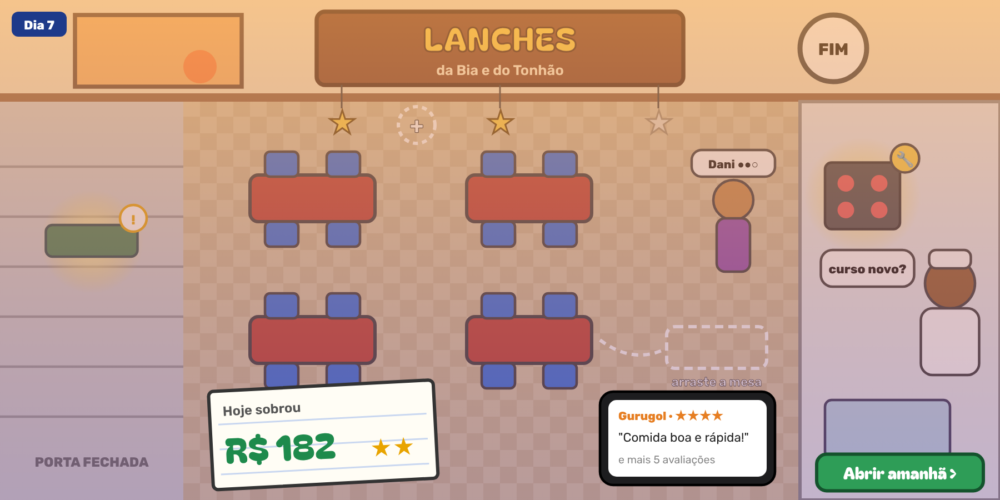
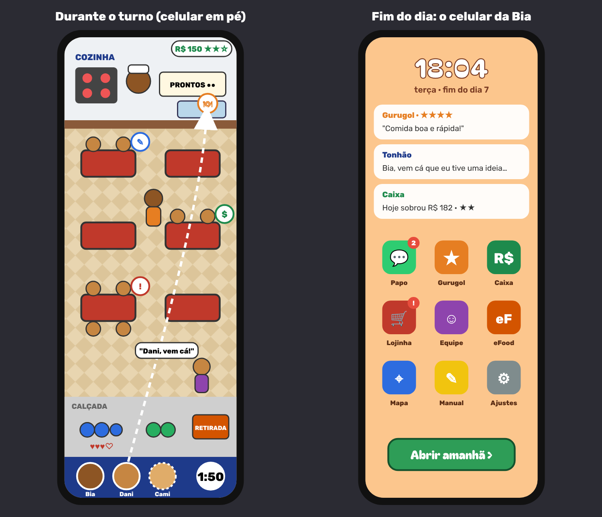
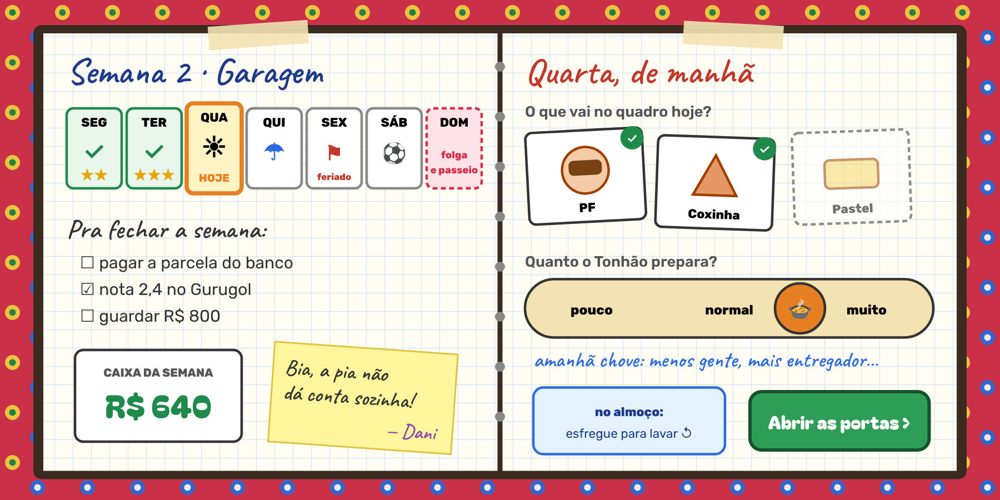

# Redesenho: três propostas (02/11, v9.6.11)

> Pedido do usuário (02/11), antes da 4a: "repensar toda a forma de interface de usuário, de interface do jogo, de jogabilidade [...] se isso poderia ser feito de uma forma totalmente diferente e que fosse melhor do que atualmente [...] 3 propostas de jogabilidade, de organização desse jogo, de estética e de forma de jogo, que abrace todas as funcionalidades que já estão."
> Esboços (desenho de ideia, não arte final): `docs/redesenho/p1.png`, `p2.png`, `p3.png` (fonte em `docs/redesenho/*.html`).
> **Nada aqui está decidido.** O usuário escolhe uma proposta (ou uma mistura); depois, o plano detalhado é com o Opus, como sempre.

---

## 1. Por que repensar (o que o crescimento deixou)

A tela e o jeito de jogar são os da v1: a Bia, vista de frente, num salão com a calçada à esquerda, a cozinha à direita e uma barra de números embaixo. Cada versão encaixou mais uma coisa nesse mesmo quadro. O que se vê nas capturas da v9.6.11 (Garagem e Avenida, no pico):

1. **O jogo de verdade fica fora do mundo.** Tudo o que não é o turno abre por cima, em janelas: lojinha (4 abas, 13 cartões), fim do dia (tabelas e balões), Manual (6 abas), conversas, banco, caixa e mudança. O salão, que é o lugar mais bonito do jogo, só serve de fundo para os menus.
2. **"Não sei onde gastar"** (Letícia, 02/11): as compras moram em cartões dentro de abas, e não no lugar onde o problema aparece. A 3g-1 adiantou os cartões, mas o problema é de lugar, não de data.
3. **A tela lota a cada ponto.** Na Avenida convivem espera em sofá, retirada, drinks, vitrine, café, Cami, Dani, Joca, Anselmo, VIP e fiscal, e o Terraço ainda vai trazer a refeição em quatro tempos. Os ajustes da 3e-1 tiraram a tela do sufoco, mas é o mesmo quadro de 1220×600 recebendo mais coisa.
4. **Números demais no turno, apesar da regra "sentir, não calcular".** A barra de baixo mostra dinheiro, pontos, grupos 11/24, meta, a 3ª estrela, a nota do Gurugol e a fila de 8 casas. Os **pontos** e a **corrente de cores** vêm da v1 e hoje não decidem nada na História (a meta é o lucro).
5. **A equipe trabalha sozinha.** Dani, Joca, Cami e Anselmo são contratados, sobem de nível e fazem sua parte, mas o jogador só manda na Bia. A turma cresce e a mão do jogador continua do mesmo tamanho.
6. **O celular joga deitado e apertado.** O app (PWA) existe, mas o quadro largo encolhe no celular deitado, e a lojinha ainda rola no 568×320.

O que **funciona** e as três propostas mantêm: o corre-corre da Bia (os testadores gostam), os personagens e a história, o Gurugol, a escada de pontos, a lojinha que se abre pelas reclamações e o Manual que se revela.

## 2. O que toda proposta precisa abraçar

Missão zero, abertura animada, Modo História (7 capítulos até a Avenida, conversas, objetivo por capítulo) e Turno sem fim · Bia (fila de ações, bandeja e mão, tênis, Sudoku) · Tonhão (cursos, níveis, aumento, pia) · Dani, Joca, Cami (minhas mesas) e Anselmo · tipos de cliente, VIP e vegetariano · espera lá fora, água e assentos · corações, gorjeta, cores · pedido, prato, conta, louça, lixo e fumaça · suco, cafezinho, doces, espresso e drinks · entregador, eFood, marmita e encomenda · melhorias, salão (editor), decoração, manutenção e quebras, divulgação, banco e empréstimo, caixa, mudança · Gurugol (nota, comentários, ambiente) · metas, estrelas e falência · imprevistos (chuva, feriado, gripe, apito, fiscal) · Manual · ranking local · modo dev · PWA. E o que já está planejado: Terraço e refeição completa (4a), nível de luxo (4b), eventos de bairro (4c), Michelzão e o final (6).

---

## Proposta 1 — "A casa é o menu" (tudo dentro da lanchonete)

**Em uma frase:** a jogabilidade do turno continua quase igual, mas **os menus somem**: quando a porta fecha, o próprio salão vira a lojinha, o caixa, o Gurugol e a história. Toca-se nas coisas, e não em cartões.

**Jogabilidade**
- O turno é o de hoje: a Bia, a fila de ações e o ciclo da mesa. O que muda é o que aparece na tela:
  - **Turno com quase nenhum número:** o relógio na parede; o dinheiro numa caixa registradora no balcão, que tilinta e mostra o total; e **as três estrelas da meta penduradas no letreiro**, que acendem quando se chega lá. A fila de ações vira bolinhas numeradas sobre a cabeça da Bia, e a barra de baixo some.
  - **Saem os pontos e a corrente** do Modo História (ficam só no Turno sem fim, que é de recorde). A cor da cadeira vira só um brilho de gorjeta.
  - **A luz anda com o dia:** manhã clara, almoço com sol a pino e fim de tarde alaranjado. É o jeito de sentir o tempo sem olhar o relógio.
- **Fim do expediente (o centro da proposta):** a porta de enrolar desce, a luz fica de fim de tarde e a câmera continua no salão.
  - **O Gurugol** chega em notificações no celular da Bia, por cima do balcão, e cada estrela pula da mesa onde o grupo comeu. Isso responde ao pedido da Letícia de dar mais destaque aos comentários.
  - **O caixa** é um caderninho no balcão com um único número grande ("Hoje sobrou R$ 182") e as estrelas. O detalhe (folha, contas, banco) abre ao tocar.
  - **As conversas** acontecem na cena: os personagens entram pela porta e falam em balões no próprio salão, sem tela escura por cima.
- **A lojinha é o salão (modo reforma):** o que pode melhorar **brilha** no lugar onde o problema está.
  - Fogão, pia e cafeteira com a chave amarela ou vermelha: **Manutenção** e **Melhorias** (o fogão industrial).
  - As mesas se arrastam ali mesmo: o **editor do salão** já funciona assim.
  - Os cantos vazios mostram um "+" tracejado: **Decoração**.
  - A calçada abre o **assento da espera** e a **água**.
  - Tocar no **Tonhão** abre o **Cardápio** e os cursos; tocar em cada pessoa da **equipe**, encostada no balcão, mostra as bolinhas de nível, o aumento e os cursos. Quem vai chegar (a Dani, a Cami...) bate na porta.
  - A **Bia** abre os tênis, a bandeja e o Sudoku.
  - O **poste da calçada**, com o panfleto, é a **Divulgação**; uma **carta do banco** no balcão é o **empréstimo**; a placa "Aluga-se" vista pela janela leva à **Mudança** (um mapa da cidade desenhado, com os pontos na mesma avenida).
- **O menu principal** é a fachada de manhã: a porta de enrolar é "Continuar", o quadro-negro da calçada é o **Manual**, o mural de recados é o **Ranking** e a placa de "Turno sem fim" fica pendurada.

**Organização das telas:** 1 cena só (a lanchonete, de dia e no fim do dia) + o mapa da cidade (mudança) + as cenas de conversa da abertura. Somem 6 das 9 janelas.

**Estética:** a linha cartoon de hoje, com **luz de hora do dia**, sombras macias e letreiros **pintados à mão**, à moda dos pintores de letreiro de rua. Cada ponto ganha sua paleta: Garagem em tons de tijolo e azulejo, área industrial em cinza e amarelo de fábrica, Avenida em vinho e dourado.

**Onde fica cada coisa (as que mudam de lugar)**
| Hoje | Na proposta 1 |
|---|---|
| Barra de baixo (R$, pts, grupos, meta, Gurugol, fila) | caixa registradora, estrelas no letreiro, bolinhas sobre a Bia |
| Lojinha: 4 abas e 13 cartões | objetos que brilham no salão, no fim do dia |
| Fim do dia (tabelas e balões) | caderninho com um número + celular com o Gurugol |
| Conversas (tela escura) | os personagens entram e falam no salão |
| Manual | caderno da Bia no balcão (o mesmo conteúdo) |
| Banco, Caixa e Mudança | carta do banco, caderninho e placa "Aluga-se" |

**Ganha:** os menus deixam de esconder o jogo; "onde gastar" fica à vista; menos números; a história mora no lugar. **Perde:** comprar fica mais lento para quem já sabe tudo (solução: um botão "lista", com os mesmos itens em fileira). **Custo:** médio. A lógica (`Game.update`) quase não muda; refaz-se a interface (`40-42`), a barra (`22-salao-hud`) e o fim do dia, e os smokes que clicam nos cartões da lojinha. **5 a 7 sessões**, que podem sair uma a uma sem quebrar o jogo (primeiro a barra, depois o fim do dia, depois a lojinha).

---

## Proposta 2 — "Na palma da mão" (celular em pé, a equipe na sua mão)

**Em uma frase:** o jogo vira de pé para o celular, com a cozinha no alto, o salão no meio e a calçada embaixo, perto do polegar. Quem tem equipe **comanda a turma** arrastando o rosto de cada um, e tudo o que não é o turno mora **no celular da Bia**, com apps inventados.

**Jogabilidade**
- **Tela em pé (9:16):** a cozinha (Tonhão, janela de prontos, pia) fica no alto; as mesas, em duas colunas no meio; a calçada, com a espera e a retirada, embaixo. No computador, o jogo fica no meio e o celular da Bia ao lado, sempre aberto.
- **As tarefas viram balões** sobre a mesa (anotar, levar, cobrar, limpar, café, doce, drink, marmita). Tocar no balão manda a Bia; é o jogo de hoje, com a mesma fila de ações.
- **A equipe entra na mão do jogador:** a barra de baixo mostra o rosto de cada um. Cada pessoa continua fazendo a sua parte sozinha, mas, num aperto, **arrasta-se o rosto da Dani até a pia** ("Dani, vem cá!") e ela larga o que fazia. Cada um tem um jeito, sentido e não calculado: a Cami ganha corações, a Dani é rápida na louça, o Joca acalma com o café. Com a Bia sozinha, o jogo é o de hoje; com a turma, o jogador vira o **maestro do salão**. Responde ao ponto 5 do diagnóstico.
- **Grupos chegam por baixo**, e o polegar os arrasta para cima até a mesa. Os corações ficam junto do grupo; o resto da barra some.
- **Fim do dia é a tela de bloqueio do celular**, com as notificações em cascata: "Gurugol ★★★★ 'Comida boa e rápida!'", "Tonhão: Bia, vem cá que eu tive uma ideia…", "Caixa: hoje sobrou R$ 182".
- **O celular da Bia** (apps com nomes nossos, sem imitar marcas reais):
  - **Papo:** o grupo "Corre-Corre", com as conversas do Modo História como mensagens (Tonhão, Dani, dona Rosa, Cami); o capítulo fica fixado no alto.
  - **Gurugol:** nota, comentários e ambiente.
  - **Caixa:** o livro-caixa, o banco e o empréstimo.
  - **Lojinha:** Melhorias, Salão, Decoração e Manutenção.
  - **Equipe:** cada pessoa como contato, com bolinhas, aumento e cursos; o Cardápio fica no contato do Tonhão.
  - **eFood:** marmitas e divulgação.
  - **Mapa:** pontos e mudança.
  - **Manual**, como bloco de notas.
  - **Bolinhas vermelhas nos apps** mostram o que há de novo. É o "onde gastar" do jeito que todo mundo já conhece.

**Organização das telas:** turno (em pé) + celular (tela de bloqueio e apps). A abertura e as cenas de conversa grandes continuam para os capítulos.

**Estética:** vista **de cima, um pouco inclinada** (3/4), com bonecos maiores e mais redondos, cores fortes e piso desenhado por ponto. O celular é limpo e claro, com fundo da cor do pôr do sol: é o lado "app" do jogo, que contrasta com o salão desenhado à mão.

**Onde fica cada coisa (as que mudam de lugar)**
| Hoje | Na proposta 2 |
|---|---|
| Quadro largo deitado | tela em pé; no PC, jogo + celular lado a lado |
| Só a Bia recebe ordens | a Bia por toque; a equipe por arrasto do rosto |
| Lojinha, Equipe, Dinheiro e Gurugol (abas) | apps do celular, com bolinha de novidade |
| Conversas do fim do dia | mensagens no app Papo (os capítulos mantêm a cena grande) |
| Fim do dia | tela de bloqueio com notificações |

**Ganha:** é o melhor jeito de jogar no celular (uma mão, em pé, no ônibus); a equipe vira jogo; o celular é uma metáfora que qualquer pessoa entende. **Perde:** o salão em pé cabe menos (a Avenida, com 6 mesas, vai a 2×3 justo; o Terraço, com o piano, pede rolar um pouco); é preciso redesenhar todos os cenários (`21-cenario.js`, ~1.500 linhas); e as coordenadas de todos os smokes e do bot mudam. **Custo:** alto, **8 a 12 sessões**, e o jogo fica num branch grande até a virada (não dá para entregar aos pedaços sem ter duas telas ao mesmo tempo).

---

## Proposta 3 — "O caderno da Bia" (a semana em três tempos)

**Em uma frase:** muda o **ritmo**. A campanha vira **semanas**; cada dia tem **manhã** (escolher o que vai no quadro e quanto o Tonhão prepara), **almoço** (o corre-corre, com gestos de mão) e **fechamento**. O **domingo** é de folga e passeio pela cidade, e é lá que se compra. Tudo desenhado num caderno.

**Jogabilidade**
- **A semana (página da esquerda):** seis dias e o domingo, com a **previsão** desenhada (sol, chuva, feriado, jogo do Brasil, apito da fábrica). Os imprevistos e os **eventos de bairro** (4c) deixam de ser surpresa da introdução: viram planejamento ("quinta chove: menos gente, mais entregador"). O objetivo do capítulo vira a **lista da semana** ("pagar a parcela", "nota 2,4", "guardar R$ 800").
- **Manhã (sem relógio, uns 20 s):**
  - **O quadro do dia:** escolher 2 a 4 pratos entre os que o Tonhão sabe (recortes de papel). Os cursos ganham sentido na hora.
  - **Quanto preparar** (pouco, normal ou muito): o ingrediente, que hoje é só um custo invisível, vira coisa que se pega. Com pouco, pode acabar a coxinha no pico ("acabou!", e a freguesia escolhe outra coisa); com muito, sobra e vai para o lixo (e a fumaça já sabe o que fazer).
  - É a escolha que dá "o que fazer" no começo, como a Letícia sentiu falta no fim do dia 1.
- **Almoço:** o corre-corre de hoje, com **gestos** em vez de só toques: arrastar o prato até a mesa, **esfregar** para lavar a louça, **segurar** para encher o suco, deslizar para limpar a mesa. Gestos curtos e opcionais (o toque continua valendo): "sentir" na ponta do dedo.
- **Fechamento:** as moedas caem num pote (um número só), o Gurugol vem como bilhetes colados na página e as conversas, como recados (o post-it da Dani: "Bia, a pia não dá conta sozinha!").
- **Domingo, o passeio:** o mapa do bairro desenhado no caderno, com uma loja para cada compra:
  - a **ferragem** (Melhorias e Manutenção);
  - a **floricultura** (Decoração);
  - a **escola de culinária** (cursos do Tonhão e da equipe);
  - o **banco**;
  - a **gráfica** (Divulgação);
  - a **imobiliária** (Mudança);
  - a **praça**, onde se contrata (a Dani, a Cami...).
  - Compra-se uma vez por semana, com calma. No meio da semana, só emergência: chamar o técnico, que já existe.

**Organização das telas:** caderno (semana, manhã, fechamento e domingo) + turno. A abertura e as cenas de capítulo continuam.

**Estética:** **papel quadriculado, fita crepe, recortes, carimbos e letra de mão**, com estampa de **chita** e azulejo na capa e em cada ponto. É a mais "brasileira de casa" das três. O turno segue o cartoon de hoje, emoldurado pelo caderno.

**Onde fica cada coisa (as que mudam de lugar)**
| Hoje | Na proposta 3 |
|---|---|
| Dias soltos e capítulos | semanas, com a lista da semana como objetivo |
| Imprevisto anunciado na introdução | previsão da semana (e os eventos da 4c no calendário) |
| Ingredientes como custo escondido | quadro do dia e quanto preparar (estoque que acaba ou sobra) |
| Lojinha todo fim de dia | domingo no mapa do bairro; técnico de emergência na semana |
| Toques | toques + gestos (arrastar, esfregar, segurar) |

**Ganha:** é a que mais muda a **forma de jogar** (escolha antes, corre-corre durante, colheita depois) e dá lugar natural para os eventos (4c) e a refeição completa (4a: o Terraço escolhe o menu do dia). **Perde:** acrescenta **sistemas novos** (estoque, semana) e decisões, o que vai na contramão do "pouco texto" se não for muito bem desenhado; e mexe no **balanceamento** inteiro (`balance.js`, `carreira.js`, metas por semana). **Custo:** médio a alto, **7 a 10 sessões**, metade delas de balanceamento.

---

## 3. Comparação

| | P1 A casa é o menu | P2 Na palma da mão | P3 O caderno da Bia |
|---|---|---|---|
| Muda a interface | muito | muito | muito |
| Muda o jeito de jogar | pouco (tira números) | médio (equipe por arrasto) | muito (semana, manhã, estoque, gestos) |
| Muda a estética | média (luz, letreiros) | muita (em pé, vista de cima) | muita (caderno, chita) |
| Celular | melhora (menos coisa na tela) | **o melhor** (em pé, uma mão) | melhora (gestos) |
| "Onde gastar" | o objeto brilha | bolinha no app | domingo na loja certa |
| Risco no balanceamento | baixo | médio | alto |
| Sessões | 5 a 7, aos pedaços | 8 a 12, virada única | 7 a 10 |
| Encaixe com 4a, 4b, 4c e 6 | bom | bom | ótimo (4a e 4c ficam mais fáceis) |

## 4. Recomendação

**A proposta 1 como base, com o celular da Bia da proposta 2.** O celular entra na cena da proposta 1 como um objeto do balcão, com o Papo, o Gurugol e o Caixa. Os motivos:

- resolve os três retornos mais fortes (menus que escondem o jogo, "onde gastar" e o Gurugol sem destaque) sem tocar no corre-corre, que é o que os testadores elogiam;
- pode ser entregue aos pedaços, com o jogo inteiro funcionando a cada versão;
- é o mais barato, e quase tudo é Sonnet executando um plano.

Duas ideias da proposta 3 ficam guardadas para quando chegarem as etapas delas: a **previsão da semana** para os eventos de bairro (4c) e o **quadro do dia** para o menu completo do Terraço (4a).

**Se o jogo for pensado principalmente para o celular em pé, a proposta 2 inteira** é a que mais muda a experiência. Mas é uma virada grande, e o melhor é fazê-la **antes** do Terraço, para não desenhar o Terraço duas vezes.

**Em qualquer escolha:** decidir antes da 4a. O Terraço (refeição em quatro tempos, piano e foyer) é a tela mais cheia que o jogo vai ter e deve nascer já no formato novo.

## 5. Próximo passo

1. O usuário escolhe uma proposta (ou uma mistura) e diz o que gostou e o que não gostou em cada uma.
2. Planejar com o Opus (esforço médio ou alto) a etapa nova no `docs/PLANO.md`, antes da 4a, dividida em sessões, com valores, textos, partes de `src/` e smokes.
3. Executar com o Sonnet (médio no geral; alto no cenário em pé da proposta 2 ou no balanceamento da proposta 3).
